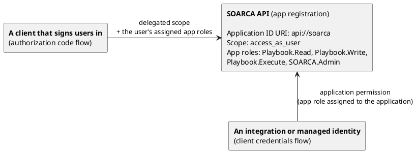

SOARCA accepts access tokens that Entra ID issues for a dedicated **SOARCA API** app registration. Permissions come from app roles on that registration, so you decide in Entra ID who may read, write or execute playbooks.

You need an account that can create app registrations and grant admin consent, for example *Application Administrator*. Note your **tenant ID** from the Entra admin center overview page.

## How it fits together

```
SOARCA API (app registration)
  Application ID URI  api://soarca
  Scope               access_as_user
  App roles           Playbook.Read, Playbook.Write, Playbook.Execute, SOARCA.Admin
     ^                                        ^
     | delegated scope                        | application permission
     | + the user's assigned app roles        | (app role assigned to the application)
     |                                        |
A client that signs users in            An integration or managed identity
(authorization code flow)               (client credentials flow)
```



One registration represents SOARCA. Everything that calls SOARCA gets its own registration, or is a managed identity. Users and groups receive app roles through assignment; applications receive them as application permissions. Either way the roles end up in the token's `roles` claim, which SOARCA maps to permissions:

| App role value | SOARCA permissions |
|---|---|
| `Playbook.Read` | `playbook:read` |
| `Playbook.Write` | `playbook:read`, `playbook:write` |
| `Playbook.Execute` | `playbook:read`, `playbook:execute` |
| `SOARCA.Admin` | all permissions |

The values are case-sensitive and must match exactly.

## 1. Register the SOARCA API

1. In the Entra admin center, go to **Identity** → **Applications** → **App registrations** → **New registration**. Name it `SOARCA API`, choose **Accounts in this organizational directory only**, leave the redirect URI empty and register.
2. Copy the **Application (client) ID**. This is `AUTH_ENTRA_API_CLIENT_ID`.
3. **Expose an API** → **Application ID URI** → **Add**. Use `api://soarca`, or accept the suggested `api://<client-id>` if your tenant doesn't allow custom URIs. This is `AUTH_ENTRA_API_APP_ID_URI`.
4. **Expose an API** → **Add a scope**: name `access_as_user`, who can consent **Admins only**, state **Enabled**.
5. **App roles** → **Create app role**, four times, each with allowed member types **Both (Users/Groups + Applications)** and the values from the table above.
6. **Manifest**: set `"requestedAccessTokenVersion": 2` in the `api` section and save. Without it, Entra ID issues v1 tokens, which SOARCA rejects unless `AUTH_ENTRA_ACCEPT_V1` is `true`.
7. **Token configuration** → **Add optional claim** → token type **Access** → `idtyp`. This tells SOARCA reliably whether a token belongs to a user or an application.
8. **Enterprise applications** → **SOARCA API** → **Properties**: set **Assignment required?** to **Yes**. Now only users, groups and applications that hold an app role can get a token for SOARCA.



API_APP_ID=$(az ad app create --display-name "SOARCA API" \
  --sign-in-audience AzureADMyOrg --query appId -o tsv)
API_OBJECT_ID=$(az ad app show --id $API_APP_ID --query id -o tsv)
az ad app update --id $API_APP_ID --identifier-uris api://soarca

cat > roles.json <<EOF
[
 {"id":"$(uuidgen)","value":"Playbook.Read","displayName":"Playbook reader","description":"Read playbooks","allowedMemberTypes":["User","Application"],"isEnabled":true},
 {"id":"$(uuidgen)","value":"Playbook.Write","displayName":"Playbook author","description":"Create and change playbooks","allowedMemberTypes":["User","Application"],"isEnabled":true},
 {"id":"$(uuidgen)","value":"Playbook.Execute","displayName":"Playbook executor","description":"Trigger playbooks","allowedMemberTypes":["User","Application"],"isEnabled":true},
 {"id":"$(uuidgen)","value":"SOARCA.Admin","displayName":"SOARCA admin","description":"Full access","allowedMemberTypes":["User","Application"],"isEnabled":true}
]
EOF
az ad app update --id $API_APP_ID --app-roles @roles.json

# Scope, v2 tokens and the idtyp claim in one call: PATCH replaces the whole "api" object.
az rest --method PATCH \
  --uri "https://graph.microsoft.com/v1.0/applications/$API_OBJECT_ID" \
  --headers Content-Type=application/json \
  --body "{
    \"api\": {
      \"requestedAccessTokenVersion\": 2,
      \"oauth2PermissionScopes\": [{
        \"id\": \"$(uuidgen)\", \"value\": \"access_as_user\", \"type\": \"Admin\",
        \"adminConsentDisplayName\": \"Access SOARCA as the signed-in user\",
        \"adminConsentDescription\": \"Lets an application call SOARCA for the signed-in user\",
        \"isEnabled\": true }]
    },
    \"optionalClaims\": { \"accessToken\": [ { \"name\": \"idtyp\" } ] }
  }"

API_SP_ID=$(az ad sp create --id $API_APP_ID --query id -o tsv)
az ad sp update --id $API_SP_ID --set appRoleAssignmentRequired=true



## 2. Give users access

**Enterprise applications** → **SOARCA API** → **Users and groups** → **Add user/group**. Pick a user or group and one of the app roles.

{}
Assigning *groups* to app roles requires Entra ID P1 or P2. Only direct members of an assigned group receive the role; nested groups are not expanded.
{}

A user token for SOARCA is requested with the scope `api://soarca/access_as_user` by any client the user signs in to. That client needs the delegated permission **SOARCA API** → `access_as_user`, with admin consent.

To test as a user without building a client, pre-authorize the Azure CLI: **Expose an API** → **Add a client application** → client ID `04b07795-8ddb-461a-bbee-02f9e1bf7b46` with the `access_as_user` scope. Then:

```bash
az login --tenant <tenant-id>
TOKEN=$(az account get-access-token --scope api://soarca/access_as_user --query accessToken -o tsv)
curl -H "Authorization: Bearer $TOKEN" http://localhost:8080/playbook/
```

## 3. Give applications access

Create one registration per integration, so you can revoke one without affecting the others and SOARCA's logs show which integration did what.

1. **App registrations** → **New registration**, e.g. `SOARCA client - Terminal`, single tenant, no redirect URI.
2. **Certificates & secrets**: upload a certificate (preferred) or create a client secret. For a secret, copy the **Value** column, not the Secret ID.
3. **API permissions** → **Add a permission** → **My APIs** → **SOARCA API** → **Application permissions**. Select only the roles the integration needs, e.g. `Playbook.Execute`.
4. **Grant admin consent**. The status column must show a green check.

The integration requests a token with the client credentials flow. The scope is always `api://soarca/.default`:

```bash
TOKEN=$(curl -s https://login.microsoftonline.com/$TENANT_ID/oauth2/v2.0/token \
  -d grant_type=client_credentials \
  -d client_id=$CLIENT_ID \
  --data-urlencode client_secret=$CLIENT_SECRET \
  -d scope=api://soarca/.default | jq -r .access_token)

curl -X POST -H "Authorization: Bearer $TOKEN" -H "Content-Type: application/json" \
  -d @playbook.json http://localhost:8080/trigger/playbook
```

{}
Workloads running in Azure can use a **managed identity** instead of a secret. Assign the app role to the managed identity's service principal (`az rest --method POST --uri "https://graph.microsoft.com/v1.0/servicePrincipals/<SOARCA API SP ID>/appRoleAssignedTo"` with its `principalId`) and request a token for `api://soarca/.default` inside the workload.
{}

To accept only specific applications, list their client IDs in `AUTH_ENTRA_ALLOWED_CLIENT_IDS`. Include the client that signs users in, or user tokens are rejected too.

## 4. Configure SOARCA



AUTH_ENABLED: true
AUTH_ENTRA_TENANT_IDS: "<tenant-id>"
AUTH_ENTRA_API_CLIENT_ID: "<SOARCA API client ID>"
AUTH_ENTRA_API_APP_ID_URI: "api://soarca"



SOARCA downloads the tenant's signing keys from Entra ID on the first request and caches them, so it needs outbound HTTPS access to `login.microsoftonline.com`.

## Troubleshooting

Decode the token as described in [Checking a token](../#checking-a-token).

| Symptom | Cause | Fix |
|---|---|---|
| `iss` is `https://sts.windows.net/…`, `ver` is `1.0` | v1 tokens | Set `requestedAccessTokenVersion` to `2` on the **SOARCA API** registration and request a new token. |
| `aud` is `00000003-0000-0000-c000-000000000000` or `https://graph.microsoft.com` | A Microsoft Graph token was requested | Use the scope `api://soarca/.default` (applications) or `api://soarca/access_as_user` (users). |
| No `roles` claim, SOARCA answers `403` | No app role assigned, or consent missing | Check **API permissions** for a green check, and **Users and groups** on the enterprise application. |
| `AADSTS501051` when requesting a token | Assignment is required and the caller holds no app role | Assign an app role. |
| `AADSTS500011` | The Application ID URI in the scope is wrong | Use the exact URI from **Expose an API**. |
| `AADSTS7000215` | Wrong client secret | Use the secret's **Value**, not its ID, and check that it hasn't expired. |
| SOARCA answers `401` for user tokens only | The token lacks the `access_as_user` scope, or the signing-in client isn't in `AUTH_ENTRA_ALLOWED_CLIENT_IDS` | Request `api://soarca/access_as_user`; check the allowlist. |
| A role change has no effect | Entra ID caches tokens for 60–90 minutes, managed identities up to 24 hours | Request a new token. |
